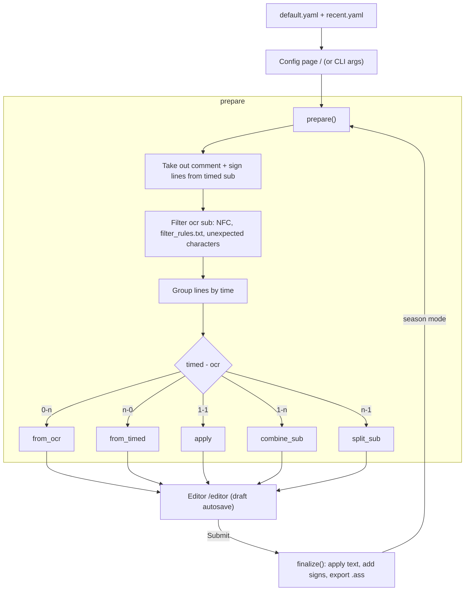

# syncsub

Transfer timing from a timed subtitle (eg. English .ass) to an OCR / softsub subtitle (eg. Vietnamese .srt).
Lines are matched by overlapping time, then reviewed in a browser editor before export.

## Usage
- Run `python syncsub.py` (or `syncsub.exe`), settings and editor open in browser (http://127.0.0.1:5000, or a free port if 5000 is busy)
- File / Folder / Save as buttons open the Windows file dialog (on the computer running syncsub)
- Empty output = `<timed sub name>.synced.ass` next to timed sub. If 2 versions are offset (BD vs TV), set "Shift OCR sub (ms)"
- Season mode: put 2 folders in Timed sub / OCR sub, files are paired by episode number
  (`S01E05`, `- 05`, `05 [1080p]`...). Output field can be a folder, otherwise outputs go next to timed subs.
  After Submit, next episode opens automatically.
- Editor autosaves a draft (`<output>.draft.json`); reopen the same files to continue, draft is removed after Submit.
- Command line: every setting in `default.yaml` can be passed as `--name value`, the editor then opens directly.

## Features
- Auto-detect lines that need combining (1 timed - n OCR) or splitting (n timed - 1 OCR)
- Warn about unexpected characters (eg. Japanese in OCR sub) and remove lines with > 60% characters not in `characters` (default.yaml)
- Auto fix decomposed unicode (Unicode NFC)
- Filter rules in `filter_rules.txt`: replace, regular expression, replace word

## Setup / Build
- `pip install -r requirements.txt`
- Test: `python -m unittest discover test`
- Build: see `.github/workflows/python-app.yml` (pyinstaller needs `--collect-data pyvi --hidden-import sklearn_crfsuite`)

## How it works

Based on [Sync-timing-subtitles](https://github.com/luudanmatcuoi-vn/Sync-timing-subtitles) by Luudanmatcuoi.
